<a href="https://github.com/Abdulel3h">
  <picture>
    <source media="(max-width: 600px)" srcset="assets/terminal-mobile.svg">
    
  </picture>
</a>

**An Arabic academic assistant that answers university questions from local FAQ data and a model served on the same machine.**

Prototype built around University of Bisha academic content. It is not deployed for students and has no automated answer-quality evaluation.

###### HOW IT WORKS

1. **Load the knowledge.** `prepare_data.py` reads the curated question–answer pairs in `data/`.
2. **Prepare the Arabic.** `text_similarity.py` removes NLTK Arabic stop words.
3. **Match by meaning.** Multilingual sentence embeddings select the nearest FAQ entry as context.
4. **Answer locally.** The `chatub` model defined in `Modelfile` writes a short Arabic reply through Ollama.

###### EVIDENCE

Implemented and readable in the source. None of these is a measured quality result.

| Capability | Where it lives |
|---|---|
| Arabic chat interface | `index.html`, `script.js`, `styles.css` |
| `/ask` JSON endpoint | `app.py` |
| Local FAQ loading | `prepare_data.py`, `data/*.json` |
| Semantic matching | `text_similarity.py` |
| Local generation | `Modelfile` |

**Not claimed:** grounded answers in every case. When no FAQ passes the similarity threshold, generation can continue without context. There is no accuracy or hallucination test set, the official sources behind `data/` are not yet documented, and committed model and checkpoint artifacts make the repository large. [All limitations](docs/overview.md#limitations)

<details>
<summary>Screenshot</summary>


Captured from the committed static chat interface.
</details>

###### QUICK START

```bash
python -m venv .venv
. .venv/Scripts/activate           # macOS/Linux: . .venv/bin/activate
pip install -r requirements.txt
ollama create chatub -f Modelfile
python app.py
```

Open `http://127.0.0.1:5000`, or ask directly:

```bash
curl -X POST http://127.0.0.1:5000/ask \
  -H "Content-Type: application/json" \
  -d "{\"question\":\"ما شروط الاعتذار عن مقرر؟\"}"
```

###### DOCUMENTATION

[Overview](docs/overview.md) · [Architecture](docs/architecture.md) · [Case study](docs/case-study.md) · [Engineering principles](docs/engineering-principles.md) · [Technical decisions](docs/technical-decisions.md) · [Reviewer guide](docs/reviewer-guide.md) · [Case study on abdulelah.de](https://www.abdulelah.de/projects/chatub)

<sub>[Abdulelah Alkhathami](https://github.com/Abdulel3h) · [abdulelah.de](https://www.abdulelah.de) · No license file yet, so all rights are reserved by default.</sub>
